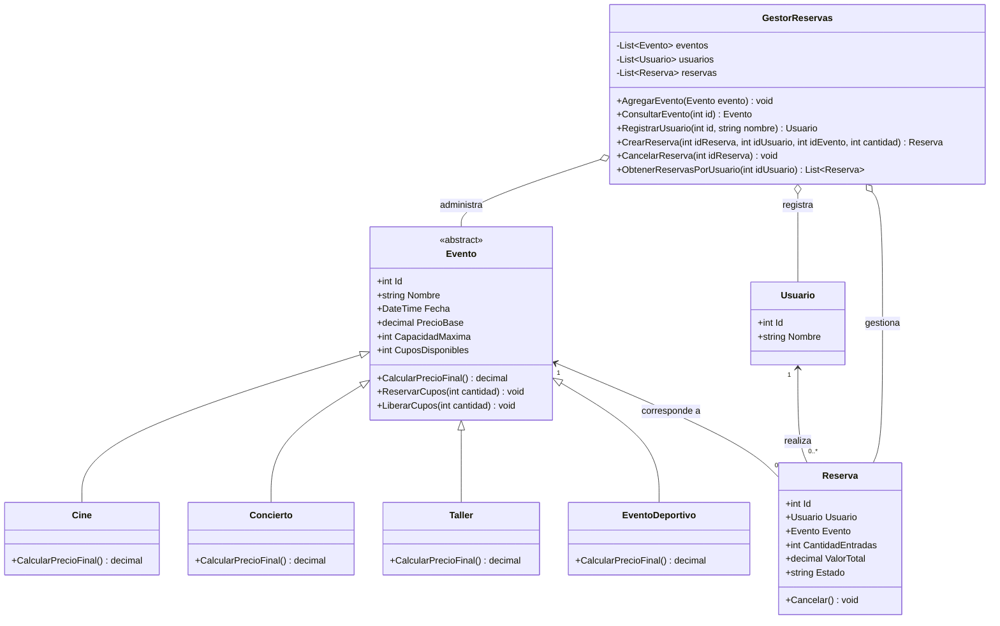

# PLANAZO - Sistema de Reservas de Eventos

## Descripción del proyecto

PLANAZO es una aplicación de consola desarrollada en C# utilizando .NET 8. Su objetivo es administrar eventos y permitir que los usuarios realicen reservas de entradas.

Este proyecto fue desarrollado para aplicar los conceptos de Programación Orientada a Objetos (POO), como abstracción, herencia, encapsulamiento y polimorfismo.

## Funcionalidades

El sistema permite:

- Visualizar los eventos disponibles.
- Consultar la información de un evento.
- Registrar usuarios.
- Realizar reservas de entradas.
- Validar la cantidad de cupos disponibles.
- Consultar las reservas realizadas.
- Cancelar reservas y devolver los cupos.
- Evitar que una reserva sea cancelada dos veces.
- Consultar un resumen de las reservas activas.
- Consultar las reservas realizadas por un usuario.

## Tipos de eventos

El sistema maneja cuatro tipos de eventos:

| Tipo | Cálculo del precio |
|---|---|
| Cine | Conserva el precio base |
| Concierto | Incrementa el precio base un 15% |
| Taller | Aplica un descuento del 10% |
| EventoDeportivo | Incrementa el precio base un 20% |

## Clases del proyecto

### Evento

Es una clase abstracta que contiene los atributos comunes de los eventos, como identificador, nombre, fecha, precio base y capacidad.

También permite reservar y liberar cupos.

### Cine, Concierto, Taller y EventoDeportivo

Son clases que heredan de Evento. Cada una implementa el método CalcularPrecioFinal() según el tipo de evento.

### Usuario

Representa a las personas que realizan reservas. Contiene su identificador y nombre.

### Reserva

Almacena la información de una reserva, incluyendo el usuario, evento, cantidad de entradas, valor total y estado.

Permite cancelar una reserva y devolver los cupos al evento.

### GestorReservas

Administra los eventos, usuarios y reservas mediante listas de objetos.

Contiene los métodos necesarios para consultar eventos, registrar usuarios, crear reservas, cancelarlas y generar resúmenes.

## Conceptos de Programación Orientada a Objetos

### Abstracción

Se utiliza mediante la clase abstracta Evento, que define las características y comportamientos generales de todos los eventos.

### Herencia

Las clases Cine, Concierto, Taller y EventoDeportivo heredan los atributos y métodos de Evento.

### Encapsulamiento

Se aplica al controlar la modificación de propiedades como CuposDisponibles y Estado mediante métodos específicos.

### Polimorfismo

Se utiliza cuando cada tipo de evento implementa de manera diferente el método CalcularPrecioFinal().

## Tecnologías utilizadas

- C#
- .NET 8
- Visual Studio Code
- Programación Orientada a Objetos
- Listas genéricas List<T>

## Instrucciones de ejecución

1. Tener instalado el SDK de .NET 8.
2. Abrir la carpeta del proyecto en Visual Studio Code.
3. Abrir una terminal dentro de la carpeta principal.
4. Ejecutar el siguiente comando:

```powershell
dotnet run
```

5. Seleccionar una opción del menú para utilizar el sistema.

## Menú principal

```text
1. Ver eventos disponibles
2. Consultar evento
3. Reservar entradas
4. Ver reservas realizadas
5. Cancelar una reserva
6. Ver resumen de reservas
7. Consultar reservas por usuario
0. Salir
```

## Pruebas realizadas

Se realizaron siete pruebas para comprobar el funcionamiento de la aplicación:

1. Reserva válida.
2. Reserva con cupos insuficientes.
3. Reserva con cantidad negativa.
4. Cancelación de reserva y devolución de cupos.
5. Intento de cancelar dos veces una reserva.
6. Consulta de un evento inexistente.
7. Cálculo del precio final de los diferentes tipos de eventos.

Las capturas de pantalla de estas pruebas se encuentran en la carpeta Capturas.

## Retos adicionales

Se implementaron los siguientes retos:

- EventoDeportivo con incremento del 20% en el precio.
- Clase Usuario y consulta de reservas por usuario.
- Diagrama de clases UML.

## Pregunta de sustentación

### ¿Por qué se utilizó una clase abstracta Evento en lugar de crear clases independientes?

Se utilizó una clase abstracta Evento porque todos los tipos de eventos comparten características como el nombre, la fecha, el precio y la capacidad.

Al tener una clase principal, podemos reutilizar esos atributos y métodos sin escribir el mismo código varias veces.

Además, mediante la herencia, cada tipo de evento puede tener su propia forma de calcular el precio final.

Esto facilita la organización del programa y permite agregar nuevos tipos de eventos sin modificar toda la estructura del sistema.

---
```


## Diagrama de clases UML

El siguiente diagrama muestra las clases utilizadas en PLANAZO y sus relaciones.


